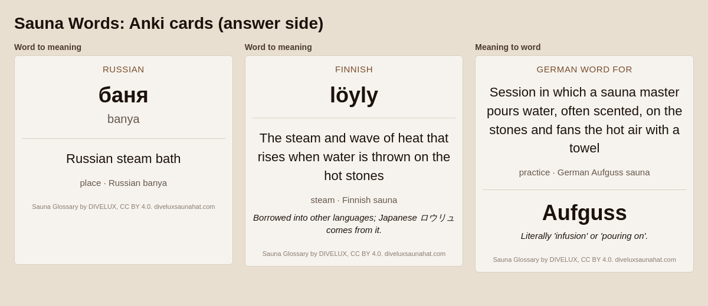

# Sauna Words: flashcards for Anki and Quizlet

145 sauna, banya and hammam words in 25 languages as ready-made flashcards: an **Anki deck** (`sauna-words.apkg`) and a **Quizlet import file** (`quizlet.txt`). Learn what *löyly*, *веник*, *Aufguss*, *kese* or *찜질방* mean before your next trip to the bathhouse.

Made by [DIVELUX](https://diveluxsaunahat.com), a small family brand in Irvine, California that makes handmade wool sauna hats. The words come from our open dataset, the [Sauna Glossary](https://doi.org/10.5281/zenodo.24387549) (CC BY 4.0).



## What is in it

| File | What it is |
| --- | --- |
| `sauna-words.apkg` | Anki deck "Sauna Words (DIVELUX)": 145 notes, 290 cards |
| `quizlet.txt` | 145 lines, `term<TAB>definition`, for Quizlet's import box |
| `flashcards.csv` | The same cards as a normal CSV with a header, for spreadsheets and other apps |
| `build_deck.py` | Builds all three from `sauna_glossary.csv` |
| `validate.py` | Checks the three files against the glossary |
| `preview.png` | Three cards, answer side |

Every word has two Anki cards:

- **Word to meaning:** the language and the word (with a Latin-script transliteration for Cyrillic, Arabic, Georgian, Japanese and Korean), then the meaning, the category, the tradition and a usage note.
- **Meaning to word:** "Russian word for: Russian steam bath", then the word.

If you only want one direction, suspend the other card type in Anki's browser (Cards: *Meaning to word*). Notes are tagged `lang::russian`, `category::place` and so on, so you can study one language or one theme with a filtered deck.

## Import into Anki

Double-click `sauna-words.apkg`, or in Anki use **File → Import** and pick the file. It works in Anki on the desktop, AnkiMobile and AnkiDroid. The deck and note type have fixed ids, so importing a newer version later updates the cards instead of making copies.

## Import into Quizlet

Quizlet imports pasted text, not files:

1. On the Quizlet website, create a new study set and choose **Import**.
2. Open `quizlet.txt`, select all, copy, and paste it into the import box.
3. Set the separator between term and definition to **Tab** and between rows to **New line**.
4. Check the preview, import, add a title such as "Sauna Words", and save.

Each line is `word (transliteration)` then a tab and `meaning [language; tradition]`.

## Rebuild

```sh
pip install genanki        # only for the .apkg; use a venv or --target if you like
python3 build_deck.py      # reads ../sauna-glossary/sauna_glossary.csv
python3 validate.py
```

`build_deck.py` takes another path to `sauna_glossary.csv` as its first argument. `validate.py` needs only the Python standard library: it opens the `.apkg` (a zip with `collection.anki2` and `media`), runs SQLite's integrity check, and confirms 145 notes, 290 cards, the deck and note type ids, every field against the glossary, and every Quizlet line.

The deck was built with genanki 0.13.1. Last run of the checks:

```text
145 terms, 145 notes, 290 cards, 145 Quizlet lines, 145 CSV rows
OK
```

## Where the words come from

All 145 terms, meanings, transliterations and notes are copied unchanged from the **Sauna Glossary** 1.0 by DIVELUX ([DOI 10.5281/zenodo.24387549](https://doi.org/10.5281/zenodo.24387549)). That dataset lists only words its compilers could confirm, and its README describes the transliteration systems and the known gaps. The flashcards add nothing to it, so any correction belongs in the glossary first.

## License

The cards (text in `sauna-words.apkg`, `quizlet.txt`, `flashcards.csv`): [CC BY 4.0](LICENSE). Credit: "Sauna Glossary by DIVELUX, diveluxsaunahat.com". The credit line is printed on every card. The scripts: [MIT](LICENSE-CODE), © 2026 DIVELUX Inc.

More free sauna tools: <https://diveluxsaunahat.com/pages/sauna-tools>
